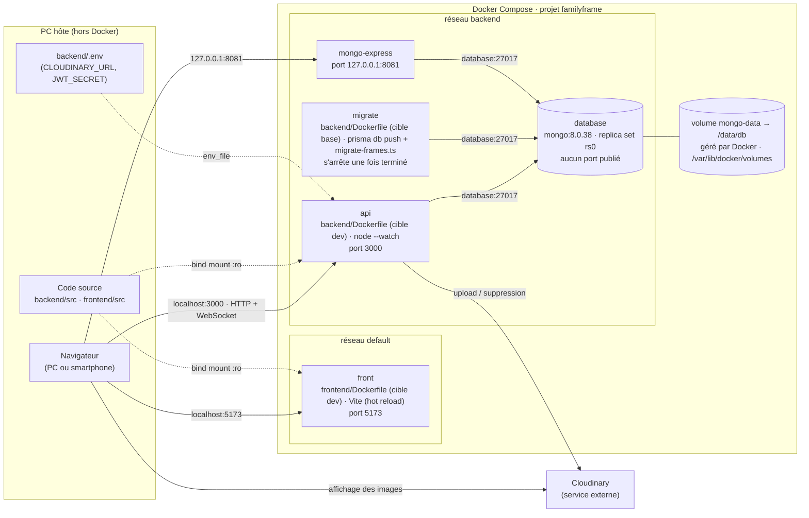
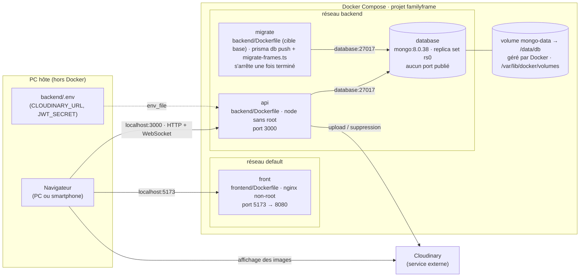
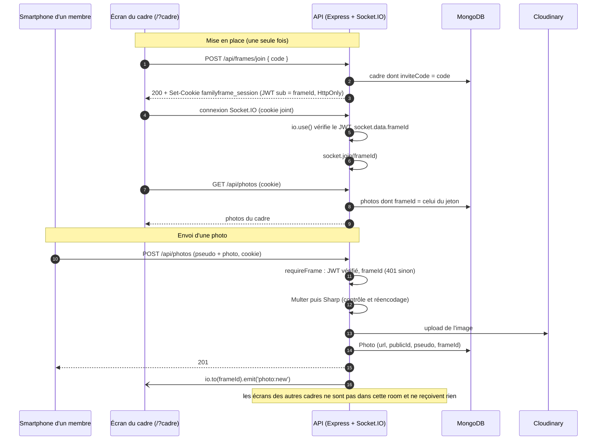
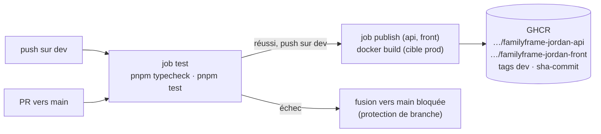

# Architecture Docker

Deux modes, qui partagent la même base `compose.yaml` :

| Mode | Commande | Fichiers chargés |
|---|---|---|
| Dev | `make dev` (ou `docker compose up -d --build`) | `compose.yaml` + `compose.override.yaml` (chargé automatiquement sans `-f`) |
| Prod | `make prod` (ou `docker compose -f compose.yaml up -d --build`) | `compose.yaml` seul |

Légende : flèche pleine = échange réseau ; flèche pointillée = montage de fichiers ou configuration.

## Dev

- **Hot reload** : `backend/src` et `frontend/src` sont montés en lecture seule depuis l'hôte ; `node --watch` relance l'API, Vite met la page à jour.
- **mongo-express** (consultation de la base) n'existe qu'en dev, et son port n'est ouvert que sur le PC (`127.0.0.1`).

## Prod

- **Code figé dans les images** : pas de bind mount ni de mongo-express.
- **API multi-stage** : l'étape `build` vérifie les types (`pnpm typecheck`) et prépare les seules dépendances de prod (`pnpm deploy --prod`) ; l'image finale lance `node src/index.ts` en utilisateur `node`, sans pnpm, CLI Prisma ni TypeScript (environ 430 Mo au lieu de 1,3 Go).
- **Front construit puis servi par nginx** : `frontend/Dockerfile` est multi-stage ; l'étape `build` lance `pnpm build` et l'image finale (nginx sans root, port 8080 dans le conteneur) ne garde que `dist/`, soit environ 30 Mo au lieu de 756 Mo. `VITE_API_URL` est passée en `build.args` : elle est inscrite dans le JS au build.

## Commun aux deux modes

- **Le navigateur appelle lui-même l'API** : aucune flèche entre `front` et `api`. Le front ne fait que servir les fichiers React ; il est donc seul sur le réseau `default`, séparé du réseau `backend`.
- **Session de cadre entre deux origines** : front (`:5173`) et API (`:3000`) sont deux origines différentes mais le même site (même hôte). Le cookie `SameSite=Lax` de l'API accompagne donc les requêtes du front, à condition que le front le demande (`credentials: 'include'`, `withCredentials: true` pour Socket.IO) et que l'API l'autorise (`Access-Control-Allow-Credentials` avec l'origine exacte `CORS_ORIGIN`, jamais `*`). C'est pourquoi la page doit être ouverte par l'adresse de `HOST_IP`.
- **api → database** par le nom du service (`database:27017`) sur le réseau `backend`. MongoDB n'a aucun port publié : seuls les conteneurs de ce réseau l'atteignent.
- **Ordre de démarrage** : `database` *healthy* → `migrate` (`prisma db push`, puis `migrate-frames.ts` qui rattache les photos sans cadre à un cadre « Famille », puis arrêt avec le code 0) → `api` (`service_completed_successfully`). En dev, `mongo-express` attend seulement `database`. Le healthcheck initialise le replica set au premier lancement (requis par Prisma 6) et ne répond « prêt » qu'une fois MongoDB primaire.
- **migrate** utilise l'étape `base` du Dockerfile de l'API, la seule qui contient le CLI Prisma.
- **Données** : les photos (métadonnées) sont dans le volume `mongo-data`, les images sur Cloudinary.
- **Depuis un smartphone** : `localhost` devient l'adresse du PC sur le Wi-Fi (`HOST_IP` dans un `.env` à la racine, voir le README).

## Sessions et temps réel par cadre

- **Le cadre vient toujours du jeton** (signé avec `JWT_SECRET`, vérifié en HS256), jamais de l'URL ni du corps de la requête : `res.locals.frameId` côté Express, `socket.data.frameId` côté Socket.IO. Supprimer la photo d'un autre cadre répond `404`, comme une photo inexistante.
- **La session du socket est vérifiée à sa connexion.** Quand on change de cadre, le front remonte le mur (`key={frame.id}`) : l'ancien socket est fermé et le nouveau se connecte avec le nouveau cookie.
- **Le code d'invitation est stocké en clair** (index unique) pour que le cadre puisse réafficher son QR code : c'est le secret d'accès du cadre.

## CI

- Les images sont construites avec les mêmes Dockerfiles que `make prod` (dernière étape = prod).
- `migrate` n'est pas publié : il sert seulement à `make dev` et `make prod`, qui construisent depuis le code.
